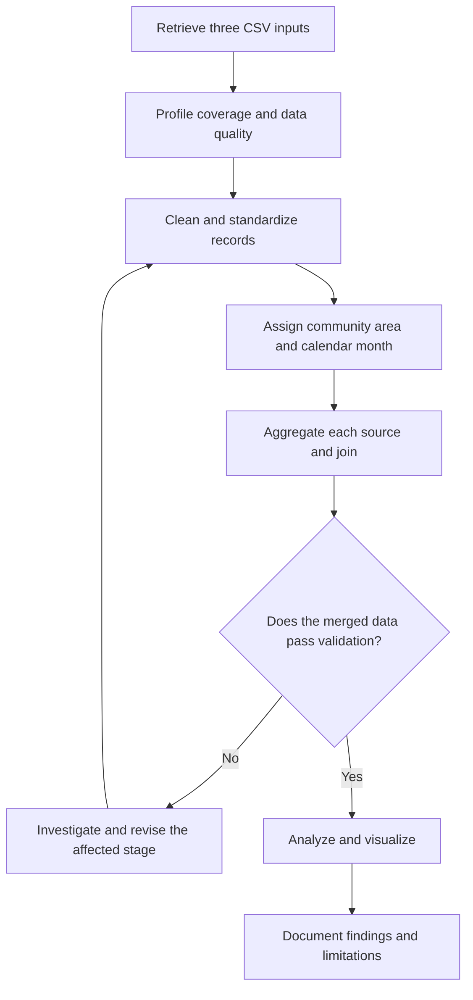

# Chicago Traffic Safety Project Workflow

**Status as of November 15, 2026:** The three retained input files are tracked in the repository, and initial profiling is documented in the [interim status report](../StatusReport.md#data-profiling). The cleaning and quality assessment files in [`script/`](../script/) are placeholders. Integration, analysis, and the automated runner are planned; the diagram shows the intended workflow, not a pipeline that already runs.

## Scope and inputs

The project will examine how reported crash frequency and severity are associated with recorded speed-camera violations and road-related 311 requests across Chicago community areas from 2019 through 2023. The unit of analysis is one **community area and calendar month**. Congestion was dropped from the original [project plan](../ProjectPlan.md) because the team did not establish a reliable way to align street-segment records with the other inputs. The revised analysis will not estimate the effect of congestion or crash risk per trip.

| Input | Role in the workflow |
|---|---|
| [Traffic crashes](../data/traffic_crashes.csv) | Count reported crashes and derive a severity measure from the available injury fields. |
| [Speed-camera violations](../data/speed_camera_violations.csv) | Sum recorded violations by area and month. These records reflect camera enforcement, not all speeding. |
| [311 service requests](../data/service_requests.csv) | Count eligible road-related requests. The input was already narrowed to CDOT requests; cleaning will apply and document the final request-type rules. |

## Workflow diagram



## Stages and expected outputs

| Stage | Work to perform | Expected output |
|---|---|---|
| Retrieve inputs | Fetch the three Git LFS files. Confirm each resolves to a readable CSV rather than a pointer. Record source links, retrieval dates, and any filters already applied. | Three readable CSVs and a record of where they came from. |
| Profile and assess quality | Check row counts, date ranges, field types, missing or invalid coordinates, and duplicates. Confirm actual coverage within 2019–2023 rather than assuming every source covers every month. | Per-source quality summary with counts and coverage gaps. Initial observations are already in the status report; supporting counts are pending. |
| Clean and standardize | Parse each source’s event date and derive a `YYYY-MM` key. Flag unusable locations, document duplicate handling, and retain only approved 311 request types. Record how many rows each rule excludes. | Cleaned inputs and a log of filtering and exclusions. |
| Assign geography | Verify any existing community-area identifiers. Where an identifier is unavailable, use valid coordinates and a documented Chicago community-area boundary file. Count records that cannot be assigned rather than silently dropping them. | Community-area and month keys for eligible records, plus a count of unassigned records. |
| Aggregate and join | Aggregate each source separately before joining on `community_area` and `month`. Count crashes and eligible 311 requests, and sum the recorded violation counts rather than counting camera rows. Preserve indicators showing where source coverage is missing or unknown. | One integrated table with no more than one row per community area and month. |
| Validate | Check key uniqueness, count unmatched keys by source, and reconcile totals before and after the join. Inspect gaps by area and month. Do not replace missing camera observations with zero unless coverage and zero violations can both be verified. | Validation summary and an integrated table ready for analysis, or documented issues to fix first. |
| Analyze and visualize | Compare crash counts and severity with camera violations and road-related 311 requests. If reporting the share of crashes involving injury, state the denominator and explain how records with unknown injury status are handled. Treat findings as associations, not causal effects. | Figures, summary tables, and an explanation of coverage and interpretation limits. |

## Reproducibility and handoff

From a fresh clone, install Git LFS if needed and run the following from the repository root:

```bash
git lfs pull
git lfs ls-files
```

Then open the three CSVs or load their headers in Python to confirm the actual data are available. A successful `git lfs ls-files` listing alone does not confirm that the CSV contents were downloaded.

Once the stage scripts are runnable, the planned `script/run_all.py` will run them in dependency order using repository-relative paths. Before wiring it up, the workflow and integration leads will agree on script names, input and output paths, and required dependencies. The runner should stop on a failed stage and should not run analysis when merge validation fails. The final reproducibility check will run the pipeline from a fresh clone and confirm that it produces the documented outputs.

Record decisions that affect interpretation alongside the workflow: retained 311 categories, date and geographic matching rules, exclusions, how missing coverage differs from zero events, and the definition and denominator of each reported metric. This addresses the Milestone 2 feedback about how integration choices affect the validity of the results.